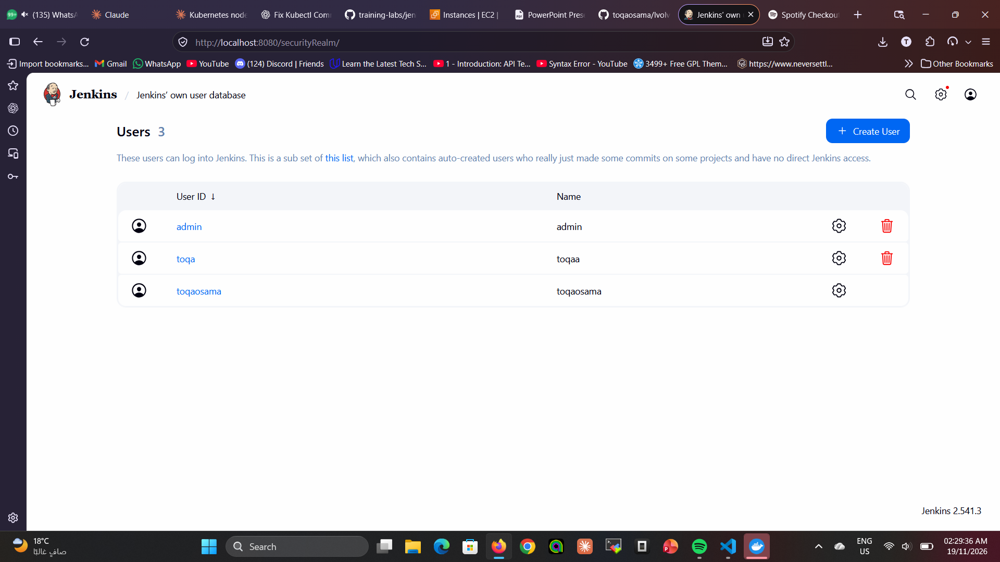
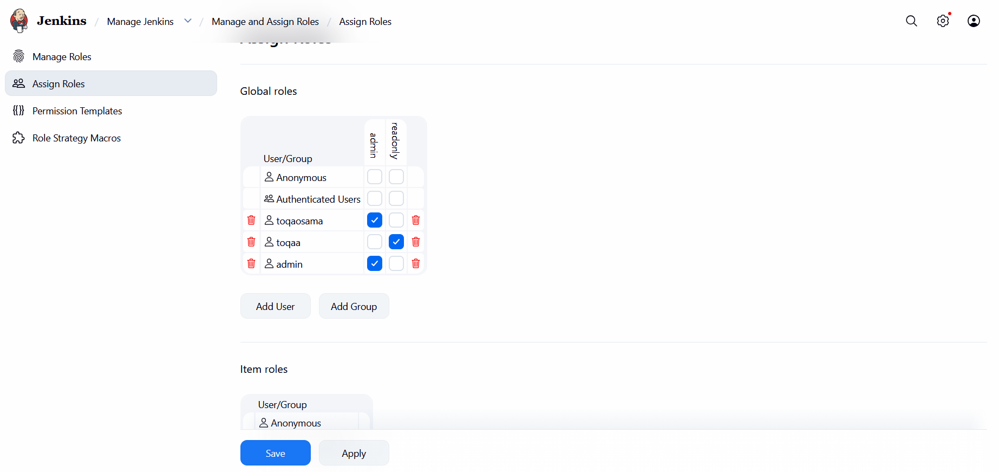

# Lab 20: Role-Based Authorization in Jenkins
 
## Objective
 
1. Create two users in Jenkins.
2. Enable role-based authorization with the **Role-based Authorization Strategy** plugin.
3. Define two global roles: `admin` (full access) and `readonly` (view only).
4. Assign the `admin` role to the first user and the `readonly` role to the second user.
5. Verify that each user only gets the permissions of the assigned role.
## Concepts
 
| Concept | Purpose |
|---------|---------|
| **Security realm** | Where users come from. Here it is Jenkins' own user database. |
| **Authorization strategy** | Decides what each user is allowed to do. By default every logged-in user can do everything. |
| **Role-based Authorization Strategy** | A plugin that groups permissions into **roles** and assigns the roles to users or groups. |
| **Global role** | A role that applies to the whole Jenkins instance (for example `Overall/Administer`). |
 
## Users used in this lab
 
The lab sheet uses the names `user1` and `user2`. In this setup the following accounts were used instead:
 
| Lab sheet | Jenkins user ID | Full name | Role |
|-----------|-----------------|-----------|------|
| `user1` | `toqaosama` | `toqaosama` | `admin` |
| `user2` | `toqa` | `toqaa` | `readonly` |
| (initial account) | `admin` | `admin` | `admin` |
 
## Environment
 
| Item | Value |
|------|-------|
| Jenkins version | `2.541.3` |
| URL | `http://localhost:8080` |
| Plugin | Role-based Authorization Strategy (`role-strategy`) |
 
---
 
## Steps
 
### 1. Create the users in Jenkins
 
Go to **Manage Jenkins > Users** and click **Create User** to add the two users (`toqaosama` and `toqa`).
 
Verify that both users appear in the user database together with the initial `admin` user:
 

 
### 2. Enable the Role-Based Authorization Strategy
 
1. Install the **Role-based Authorization Strategy** (`role-strategy`) plugin from **Manage Jenkins > Plugins**.
2. Go to **Manage Jenkins > Security**.
3. Under **Authorization**, select **Role-Based Strategy** and save the changes.
### 3. Define the roles
 
Go to **Manage Jenkins > Manage and Assign Roles > Manage Roles** and configure the **Global roles**:
 
| Role | Permissions |
|------|-------------|
| `admin` | Full administrative access (`Overall/Administer`) |
| `readonly` | View-only access (`Overall/Read`) |
 
> Tip: `Overall/Read` alone lets a user log in and see the Jenkins home page, but not the jobs. To let the `readonly` role also see jobs and views, add the read permissions (for example `Job/Read` and `View/Read`) to it, and keep all create, configure, and build permissions unchecked.
 
### 4. Assign the roles to the users
 
Go to **Manage Jenkins > Manage and Assign Roles > Assign Roles**:
 
1. Under **Global roles**, click **Add User** and enter the user ID `toqaosama`. Check the `admin` role.
2. Click **Add User** again and enter the user ID `toqa`. Check the `readonly` role.
3. Click **Save**.
Resulting assignment (the `admin` account keeps the `admin` role, and **Anonymous** and **Authenticated Users** have no role):
 

 
| User | admin | readonly |
|------|:-----:|:--------:|
| Anonymous | | |
| Authenticated Users | | |
| `toqaosama` | ✔ | |
| `toqa` | | ✔ |
| `admin` | ✔ | |
 
---
 
## Verification
 
Log in with each user and check what is allowed.
 
### Admin user (`toqaosama`)
 
Expected: full access.
 
- **Manage Jenkins** is visible and opens.
- **New Item** (job creation) is available.
- System configuration, plugins, and security settings can be opened and changed.
### Read-only user (`toqa`)
 
Expected: read-only access.
 
- Can log in and view Jenkins.
- **New Item** is **not** available (no job creation).
- **Manage Jenkins** and the configuration pages are **not** available or are denied.
- Cannot configure or delete jobs, and cannot change system settings.
---
 
## Result
 
| Check | Status |
|-------|--------|
| Two users created in Jenkins (`toqaosama`, `toqa`) | Done |
| Role-based Authorization Strategy enabled | Done |
| Global roles `admin` and `readonly` defined | Done |
| `admin` role assigned to `toqaosama`, `readonly` role assigned to `toqa` | Done |
| Login test with both users | Add a screenshot of each login to confirm |
 
## Notes
 
- Keep at least one working admin account (here `admin`) before switching the authorization strategy. Otherwise you can lock yourself out of Jenkins.
- Giving **Anonymous** or **Authenticated Users** no role means a user with no role assigned cannot do anything.
