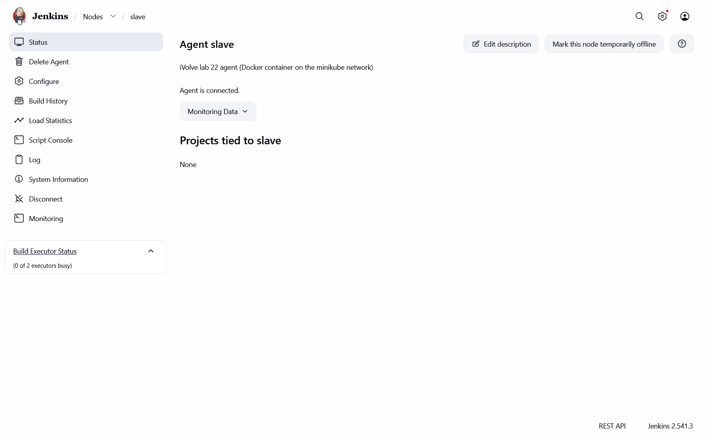
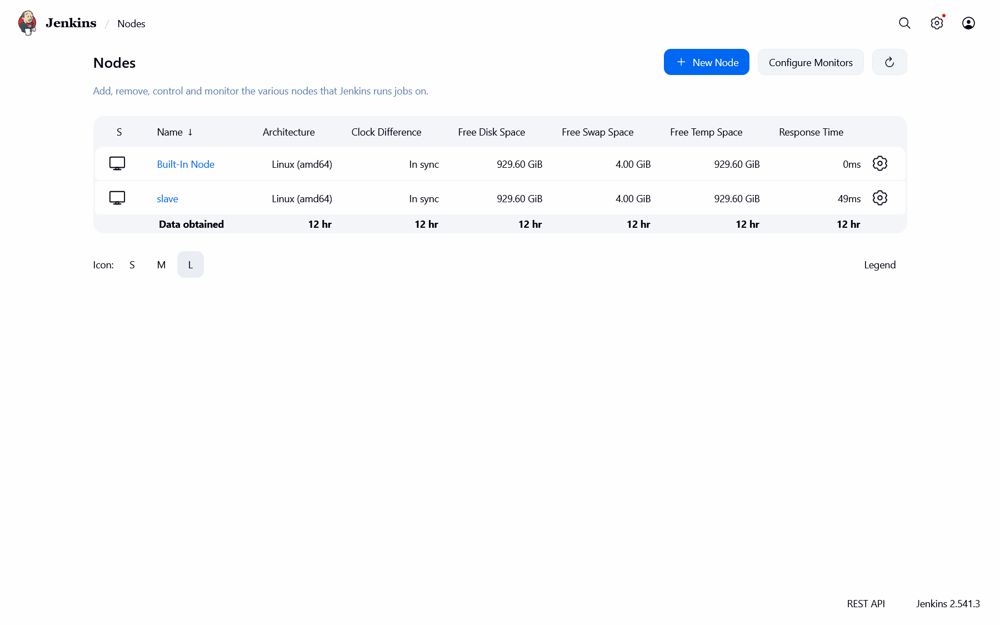
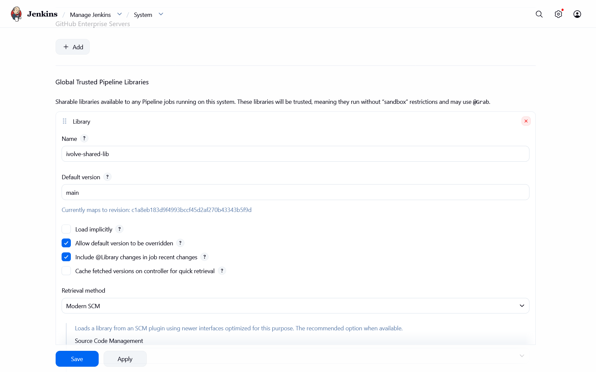
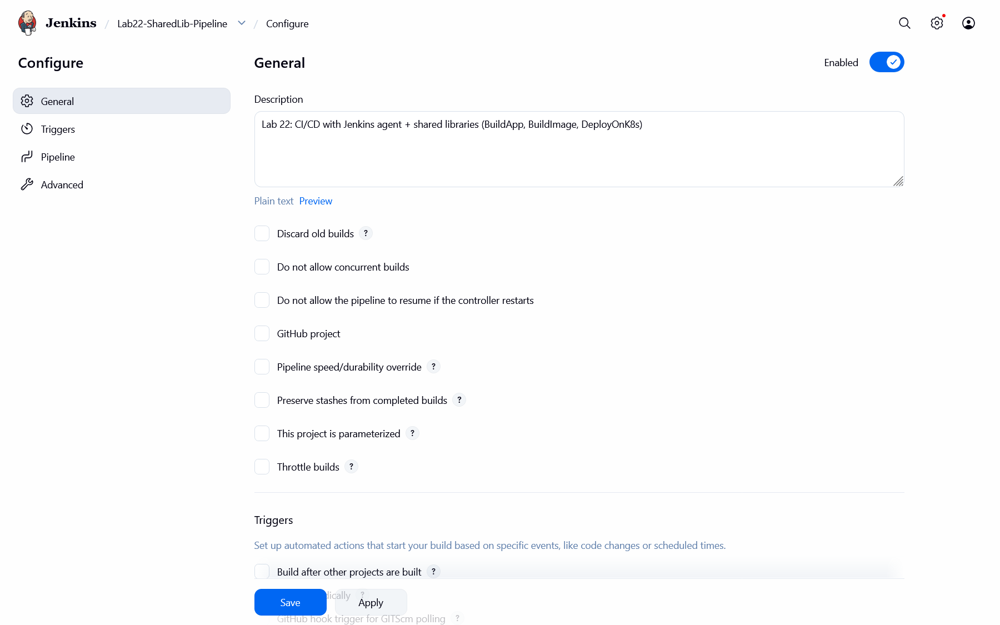
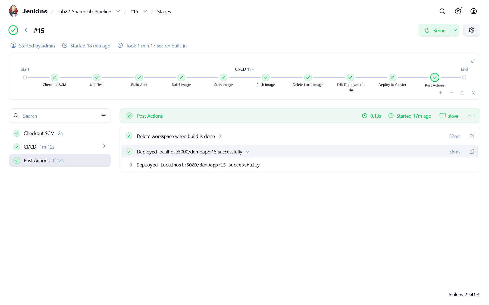
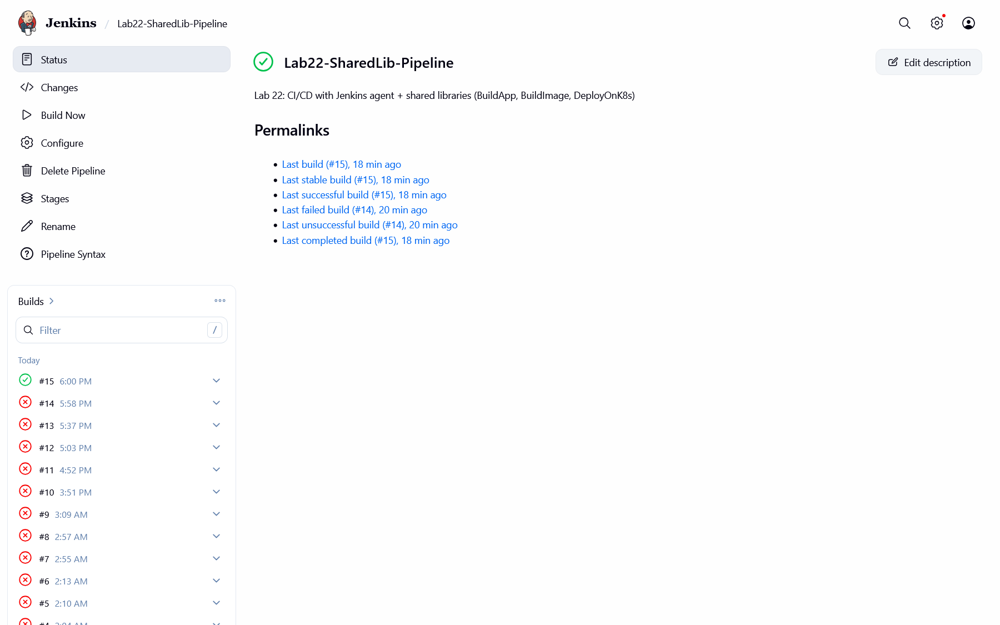
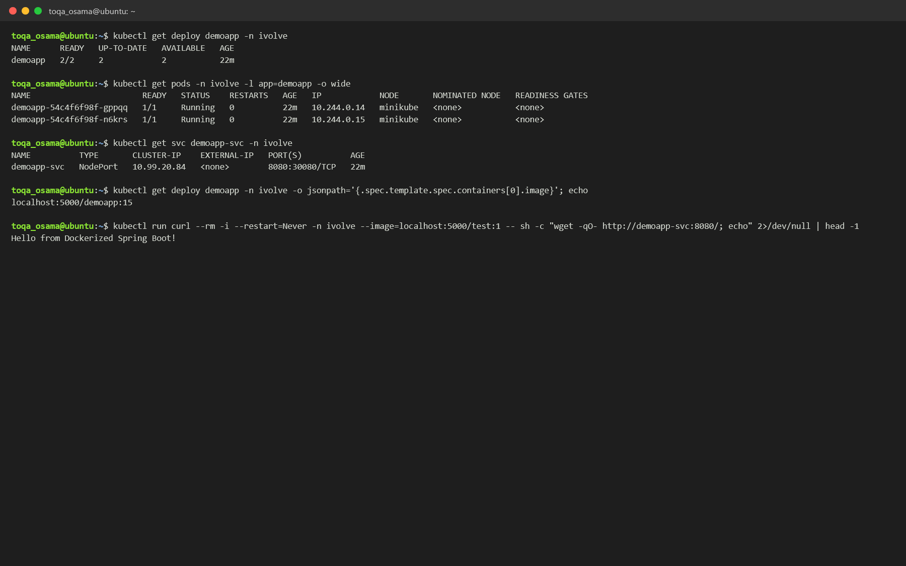

# Lab 22: CI/CD Pipeline with Jenkins Agents and Shared Libraries

## Objective

1. Take the Dockerfile/app from https://github.com/Ibrahim-Adel15/DemoApp.git
2. Create three Jenkins shared libraries:
   - `BuildApp` – unit test, build app
   - `BuildImage` – build image, scan image, push image, delete image locally
   - `DeployOnK8s` – edit deployment file, deploy to cluster
3. Update the pipeline to use them.
4. Configure a Jenkins slave (agent) to run the pipeline.

**Result:** build `#15` finished **SUCCESS** on the `slave` agent and the app runs on Kubernetes.

## Structure

```text
lab-22/
├── DemoApp/                     # Spring Boot app cloned from Ibrahim-Adel15/DemoApp
│   ├── Dockerfile
│   ├── pom.xml                  # + spring-boot-starter-test for the unit test
│   └── src/
│       ├── main/java/com/example/demo/DemoApplication.java
│       └── test/java/com/example/demo/DemoApplicationTests.java
├── shared-library/
│   └── vars/
│       ├── BuildApp.groovy
│       ├── BuildImage.groovy
│       └── DeployOnK8s.groovy
├── agent/
│   ├── Dockerfile               # image of the Jenkins slave (JDK 17, Maven, Docker CLI, Trivy, kubectl)
│   └── start-agent.sh           # alternative: run the agent directly on a Linux machine
├── deployment.yaml              # Namespace + Deployment + NodePort Service
├── Jenkinsfile
└── screenshots/
```

## Architecture

```text
GitHub repo ──► Jenkins master (container "jenkins", :8080)
                      │  label "slave"
                      ▼
               Jenkins slave (container "jenkins-slave" on the minikube network)
                ├─ BuildApp     mvn test → mvn package
                ├─ BuildImage   docker build → trivy scan → docker push localhost:5000/demoapp:<build> → docker rmi
                └─ DeployOnK8s  sed new tag into deployment.yaml → kubectl apply → rollout status
                                                   │
                                                   ▼
                                     Minikube (namespace "ivolve")
```

The master only schedules (its executors are set to 0). Every stage runs on the agent with label `slave`.

Images go to the **minikube registry addon** (`localhost:5000`), so the cluster pulls them without any
Docker Hub login. To push to Docker Hub instead, change two lines in the `Jenkinsfile`:

```groovy
REGISTRY    = "toqaosama"   // Docker Hub user
DOCKER_CRED = "docker"      // Jenkins credential with a Docker Hub access token
```

## Shared libraries

| Library | Stages | Parameters |
|---|---|---|
| `BuildApp` | Unit Test (`mvn test`), Build App (`mvn package`) | `appDir` |
| `BuildImage` | Build Image, Scan Image (Trivy), Push Image, Delete Local Image | `image`, `appDir`, `credentialsId` (empty = no `docker login`) |
| `DeployOnK8s` | Edit Deployment File (`sed` new tag), Deploy to Cluster (`kubectl apply` + rollout) | `image`, `manifest`, `deployment`, `namespace`, `kubeconfigId` |

Pipeline usage ([Jenkinsfile](Jenkinsfile)):

```groovy
@Library('ivolve-shared-lib') _
...
BuildApp(appDir: 'lab-22/DemoApp')
BuildImage(image: env.IMAGE, appDir: 'lab-22/DemoApp', credentialsId: env.DOCKER_CRED)
DeployOnK8s(image: env.IMAGE, manifest: 'lab-22/deployment.yaml', deployment: 'demoapp', namespace: 'ivolve')
```

## Steps

### 1. Local registry in minikube

```bash
minikube start
minikube addons enable registry
# forward localhost:5000 (Docker) to the registry inside minikube
docker run -d --name registry-fwd --network minikube -p 5000:5000 \
  alpine/socat tcp-listen:5000,fork,reuseaddr tcp-connect:$(minikube ip):5000
```

### 2. Build the agent image

```bash
docker build -t ivolve/jenkins-agent:lab22 lab-22/agent
```

### 3. Create the agent node in Jenkins

**Manage Jenkins → Nodes → New Node**

| Field | Value |
|---|---|
| Name | `slave` |
| Type | Permanent Agent |
| Remote root directory | `/home/jenkins/agent` |
| Labels | `slave` |
| Usage | Only build jobs with label expressions matching this node |
| Launch method | Launch agent by connecting it to the controller |

Then set **Built-In Node → Number of executors = 0** so builds only run on the agent.

### 4. Start the agent

Copy the secret from the node page and run the agent on the `minikube` network
(so it can reach the cluster API at `192.168.58.2:8443`):

```bash
docker run -d --name jenkins-slave --network minikube \
  -v /var/run/docker.sock:/var/run/docker.sock \
  -e JENKINS_URL=http://jenkins:8080 -e JENKINS_AGENT_NAME=slave \
  -e JENKINS_SECRET=<secret> -e JENKINS_WEB_SOCKET=true \
  -e JENKINS_AGENT_WORKDIR=/home/jenkins/agent \
  ivolve/jenkins-agent:lab22
```

> Start minikube **before** the Jenkins containers on the `minikube` network, otherwise one of them
> takes the IP `192.168.58.2` that minikube needs.

The node shows **Agent is connected**:





### 5. Register the shared library

**Manage Jenkins → System → Global Trusted Pipeline Libraries → Add**

| Field | Value |
|---|---|
| Name | `ivolve-shared-lib` |
| Default version | `main` |
| Retrieval method | Modern SCM → Git |
| Project repository | `https://github.com/toqaosama/IvolveT.git` |
| Library Path | `lab-22/shared-library` |



### 6. Credentials

| ID | Type | Scope | Purpose |
|---|---|---|---|
| `kubeconfig` | Secret file | **Global** | kubeconfig of the minikube cluster (`kubectl config view --raw --flatten`) |
| `docker` | Username with password | Global | only needed when pushing to Docker Hub (access token as password) |

> The `kubeconfig` credential must have **Global** scope. With **System** scope, jobs fail with
> `Could not find credentials entry with ID 'kubeconfig'`.

### 7. Create the pipeline job

**New Item → Pipeline → Pipeline script from SCM**

- Repository: `https://github.com/toqaosama/IvolveT.git`, branch `*/main`
- Script Path: `lab-22/Jenkinsfile`



Click **Build Now**.

### 8. Pipeline result

All stages pass on the `slave` agent: Checkout → Unit Test → Build App → Build Image → Scan Image →
Push Image → Delete Local Image → Edit Deployment File → Deploy to Cluster.





### 9. Verify on Kubernetes

```bash
kubectl get deploy demoapp -n ivolve
kubectl get pods -n ivolve -l app=demoapp -o wide
kubectl get svc demoapp-svc -n ivolve
```

The deployment runs the image built by the pipeline (`localhost:5000/demoapp:15`) and the app answers
`Hello from Dockerized Spring Boot!`:



## Troubleshooting notes

| Problem | Fix |
|---|---|
| `docker login ... incorrect username or password` | Use a Docker Hub **access token** in the `docker` credential (Update credential → **Change Password**), or push to the local registry |
| Checkout very slow / `early EOF` | The repo contains a 98 MB file (`Docker-Labs/lab3-4/lab-image.tar`). The job uses a reference repo on the agent (`/home/jenkins/ref/IvolveT.git`) so only new objects are downloaded |
| `Could not find credentials entry with ID 'kubeconfig'` | Change the credential scope from System to Global |
