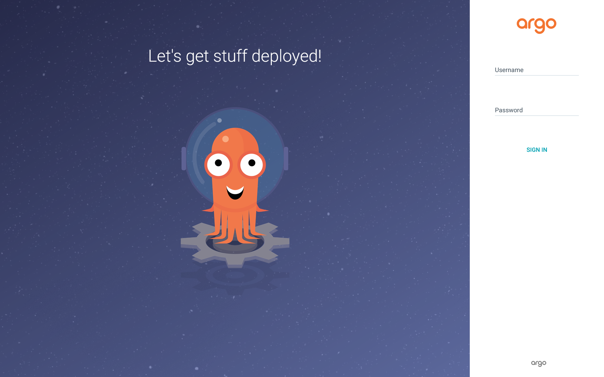
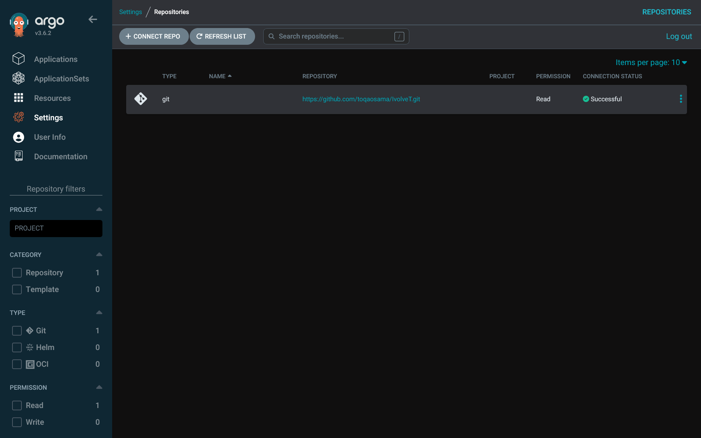
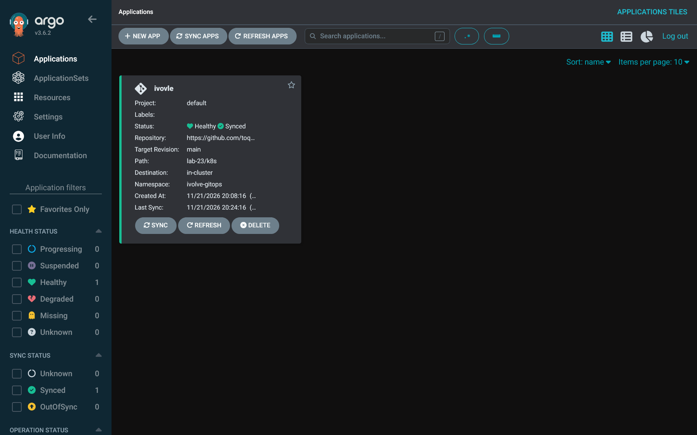
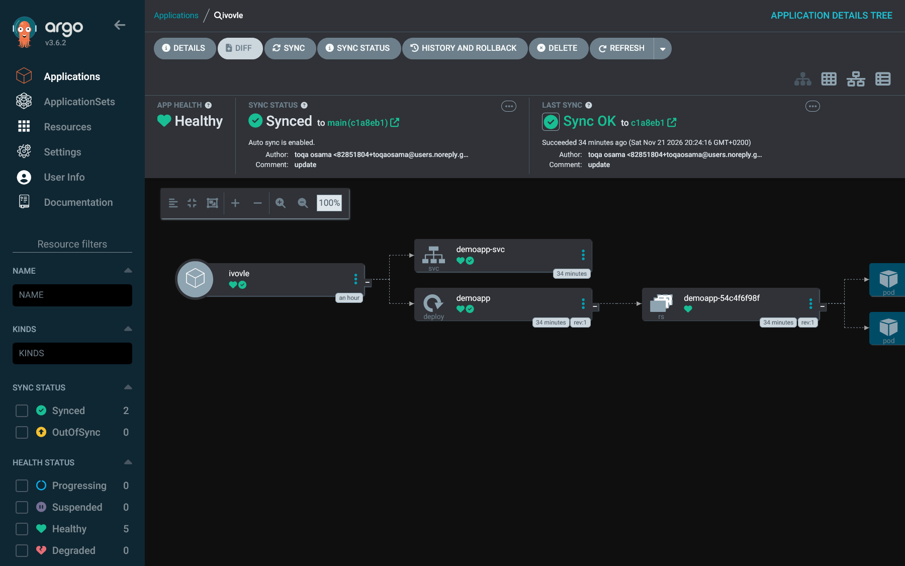
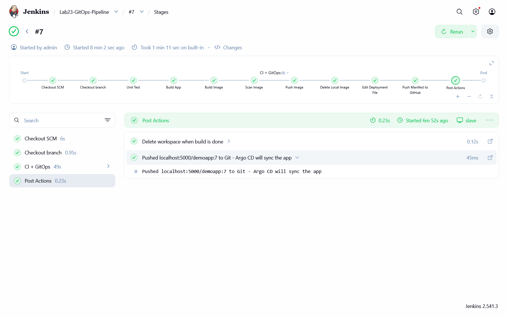
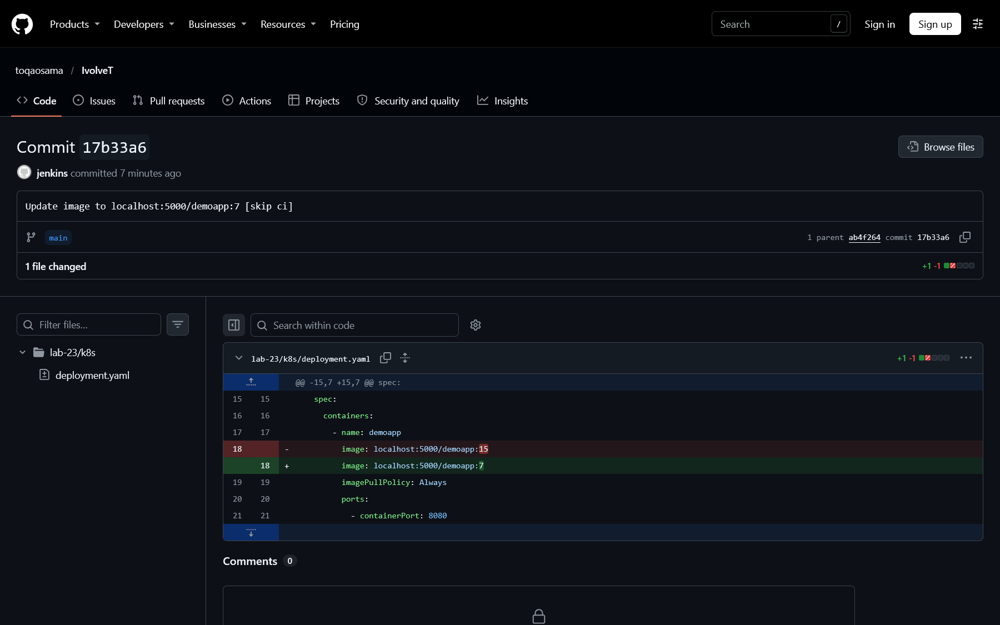
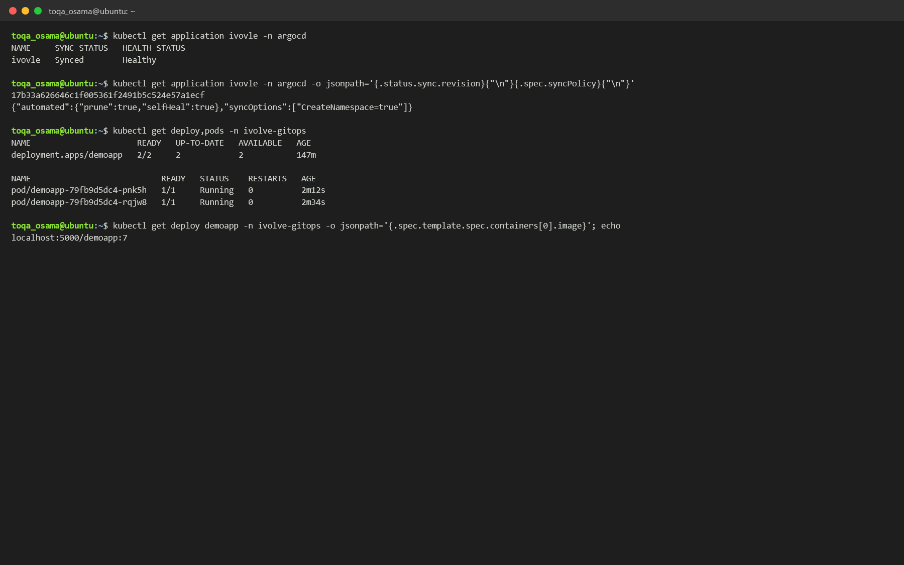

# Lab 23: GitOps Workflow with Jenkins and Argo CD

## Objective

1. Install Argo CD in the Kubernetes cluster and log in to the UI.
2. Connect Argo CD to the GitHub repository.
3. Create an Argo CD Application named `ivovle` that watches the manifest directory.
4. Enable automatic sync.
5. Change the `DeployOnK8s` shared library so it **pushes** the edited deployment file to GitHub instead of running `kubectl apply`.
6. Run the Jenkins pipeline and confirm Argo CD syncs the new image.

## GitOps flow

```text
 git push ──► Jenkins (agent "slave")
              ├─ BuildApp     mvn test + package
              ├─ BuildImage   docker build → trivy → push toqaosama/demoapp:<build> → rmi
              └─ DeployOnK8s  sed new tag into lab-23/k8s/deployment.yaml
                              git commit "[skip ci]" + git push ──► GitHub
                                                                      │
                                Argo CD (polls every ~3 min) ◄────────┘
                                └─ auto-sync ──► Minikube namespace "ivolve"
```

Jenkins never touches the cluster any more; Git is the single source of truth.

## Structure

```text
lab-23/
├── argocd/application.yaml        # Argo CD Application "ivovle"
├── k8s/                           # directory watched by Argo CD
│   ├── deployment.yaml
│   └── service.yaml
├── shared-library/vars/
│   ├── BuildApp.groovy            # same as lab 22
│   ├── BuildImage.groovy          # same as lab 22
│   └── DeployOnK8s.groovy         # changed: edit file + git push
└── Jenkinsfile
```

The app source is reused from `lab-22/DemoApp`.

## Steps

### 1. Install Argo CD

```bash
minikube start --driver=docker
kubectl create namespace argocd
kubectl apply -n argocd -f https://raw.githubusercontent.com/argoproj/argo-cd/stable/manifests/install.yaml
kubectl get pods -n argocd -w        # wait until all are Running
```

### 2. Open the UI and log in

For a local lab the server runs without TLS (no certificate warning):

```bash
kubectl -n argocd patch configmap argocd-cmd-params-cm --type merge -p '{"data":{"server.insecure":"true"}}'
kubectl -n argocd rollout restart deploy/argocd-server
kubectl port-forward --address 0.0.0.0 svc/argocd-server -n argocd 8443:80
# initial admin password
kubectl -n argocd get secret argocd-initial-admin-secret -o jsonpath="{.data.password}" | base64 -d; echo
```

Open http://127.0.0.1:8443 → user **`admin`** (built in, no need to create it) + the password above.



### 3. Connect the GitHub repository

**Settings → Repositories → Connect Repo**

- Connection method: HTTPS
- Repository URL: `https://github.com/toqaosama/IvolveT.git`
- (Public repo: no credentials needed. Private repo: GitHub username + personal access token.)

Or declaratively ([repository.yaml](argocd/repository.yaml), shallow clone because the repo contains a 98 MB file):

```bash
kubectl apply -f lab-23/argocd/repository.yaml
```

Status must show **Successful**:



> On a slow connection the first clone can time out (`context deadline exceeded`). Raise the timeouts:
> ```bash
> kubectl -n argocd patch configmap argocd-cmd-params-cm --type merge >   -p '{"data":{"controller.repo.server.timeout.seconds":"900","server.repo.server.timeout.seconds":"900"}}'
> kubectl -n argocd set env deploy/argocd-repo-server ARGOCD_EXEC_TIMEOUT=15m
> kubectl -n argocd rollout restart deploy/argocd-repo-server statefulset/argocd-application-controller
> ```

### 4. Create the application `ivovle` with auto-sync

Lab 23 uses its own namespace `ivolve-gitops`, so it does not touch the Lab 22 deployment.

```bash
kubectl apply -f lab-23/argocd/application.yaml
kubectl get applications -n argocd
```

`application.yaml` sets:

| Field | Value |
|---|---|
| repoURL | `https://github.com/toqaosama/IvolveT.git` |
| path | `lab-23/k8s` |
| destination namespace | `ivolve-gitops` |
| syncPolicy.automated | `prune: true`, `selfHeal: true` |
| syncOptions | `CreateNamespace=true` |

The application is **Synced** and **Healthy**, and *Auto sync is enabled*:





### 5. Configure Jenkins

Credentials:

| ID | Type | Purpose |
|---|---|---|
| `kubeconfig` | Secret file (Global scope) | not used by this pipeline (Argo CD deploys) |
| `github` | Username with password | GitHub username + Personal Access Token (scope `repo`) for the push |

Global Trusted Pipeline Library:

| Field | Value |
|---|---|
| Name | `ivolve-shared-lib-gitops` |
| Default version | `main` |
| Repository | `https://github.com/toqaosama/IvolveT.git` |
| Library Path | `lab-23/shared-library` |

Pipeline job → Pipeline script from SCM → Script Path `lab-23/Jenkinsfile`.

### 6. Trigger the pipeline

Click **Build Now**. Build `#7` passed every stage, including **Push Manifest to GitHub**:



Jenkins pushed this commit to GitHub (only the image tag in `lab-23/k8s/deployment.yaml` changed):

```text
17b33a6  Update image to localhost:5000/demoapp:7 [skip ci]
```



### 7. Confirm Argo CD synced

```bash
kubectl get application ivovle -n argocd     # SYNC STATUS: Synced, HEALTH: Healthy
kubectl get deploy demoapp -n ivolve-gitops -o jsonpath='{.spec.template.spec.containers[0].image}'
```

Argo CD detected the new commit by itself (auto-sync, about 5 minutes polling) and rolled out the
new image. The application is synced to the same commit Jenkins pushed, and the deployment runs `demoapp:7`:



The image tag must match the Jenkins build number. In the UI the app shows the new commit hash.
To sync immediately instead of waiting for the poll: **Refresh** in the UI, or
`argocd app sync ivovle`.

## Screenshots

| Step | Screenshot |
|---|---|
| Argo CD login | [argocd-login.png](screenshots/argocd-login.png) |
| Repo connected | [argocd-repo-connected.png](screenshots/argocd-repo-connected.png) |
| Application ivovle synced/healthy | [argocd-app-ivovle.png](screenshots/argocd-app-ivovle.png) |
| Jenkins pipeline build #7 | [pipeline-stages.png](screenshots/pipeline-stages.png) |
| Commit pushed by Jenkins | [github-commit.png](screenshots/github-commit.png) |
| Argo CD synced new image | [argocd-synced-cli.png](screenshots/argocd-synced-cli.png) |
