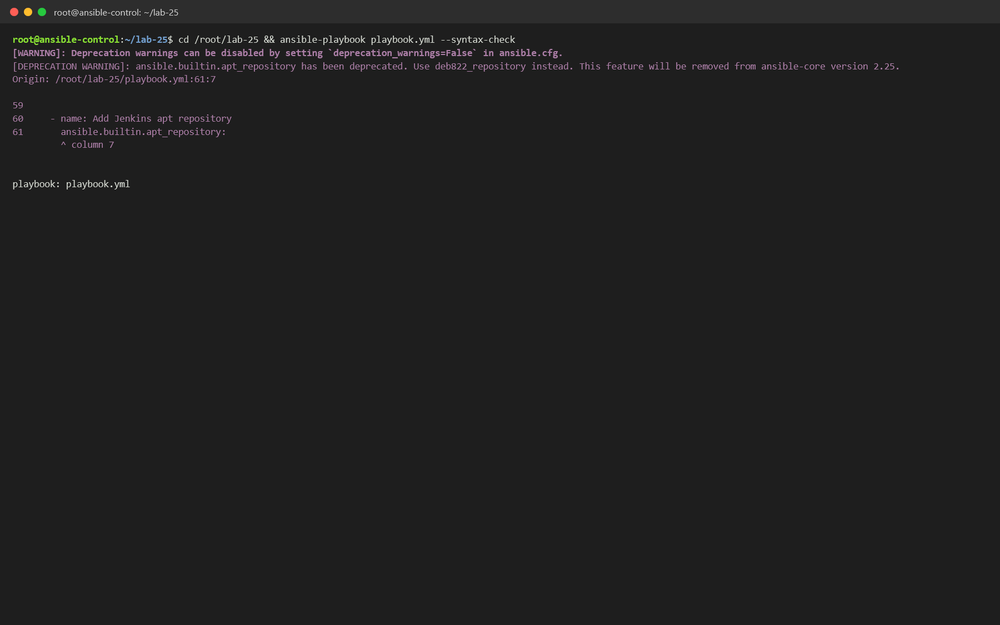
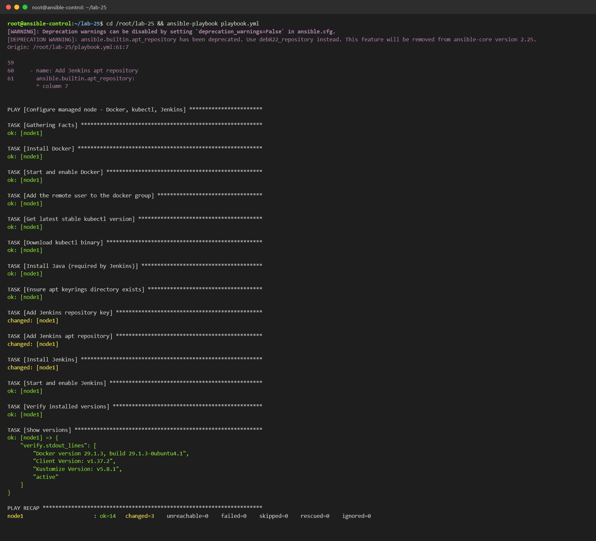
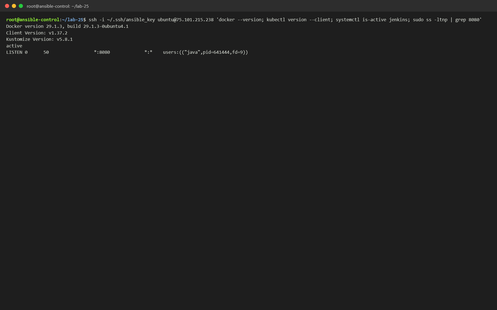

# Lab 25: Automated Server Configuration Using an Ansible Playbook

## Objective

Write one playbook that installs on the managed node:

- Docker
- kubectl
- Jenkins

then verify the result on the managed node.

> **How it was run:** the control node is a Linux container (`ansible-control`, Python 3.12 +
> `pip install ansible-core`) because `sudo` on the WSL machine needs a password. Any Linux
> control node works the same way. Managed node: AWS EC2 Ubuntu 26.04 (`75.101.215.238`).

## Files

```text
lab-25/
├── ansible.cfg
├── inventory.ini      # same managed node as lab 24
└── playbook.yml
```

## What the playbook does

| Section | Tasks |
|---|---|
| Docker | install `docker.io`, start + enable service, add `ubuntu` to the `docker` group |
| kubectl | read latest version from `dl.k8s.io/release/stable.txt`, download binary to `/usr/local/bin/kubectl` |
| Jenkins | install Java 21, add the Jenkins apt key + repo, install `jenkins`, start + enable service |
| Verify | print `docker --version`, `kubectl version --client`, `systemctl is-active jenkins` |

## Steps

```bash
cp -r /mnt/f/nti/ivolve/IvolveT/lab-25 ~/ && cd ~/lab-25
# put the managed node IP in inventory.ini

ansible-playbook playbook.yml --syntax-check
ansible-playbook playbook.yml --check      # dry run
ansible-playbook playbook.yml
```



Result: `ok=14 changed=3 failed=0` (Docker was already installed by lab 24, so only the Jenkins tasks changed):



Run it a second time: every task should be `ok` (no `changed`) - the playbook is idempotent.

## Verify on the managed node

```bash
ssh -i ~/.ssh/ansible_key ubuntu@<MANAGED_NODE_IP>
docker --version
kubectl version --client
systemctl status jenkins
sudo cat /var/lib/jenkins/secrets/initialAdminPassword
```



Open `http://<MANAGED_NODE_IP>:8080` (port 8080 must be open in the EC2 security group).

## Screenshots

| Step | Screenshot |
|---|---|
| Syntax check | [syntax-check.png](screenshots/syntax-check.png) |
| Playbook run | [playbook-run.png](screenshots/playbook-run.png) |
| Verify on managed node | [verify.png](screenshots/verify.png) |
