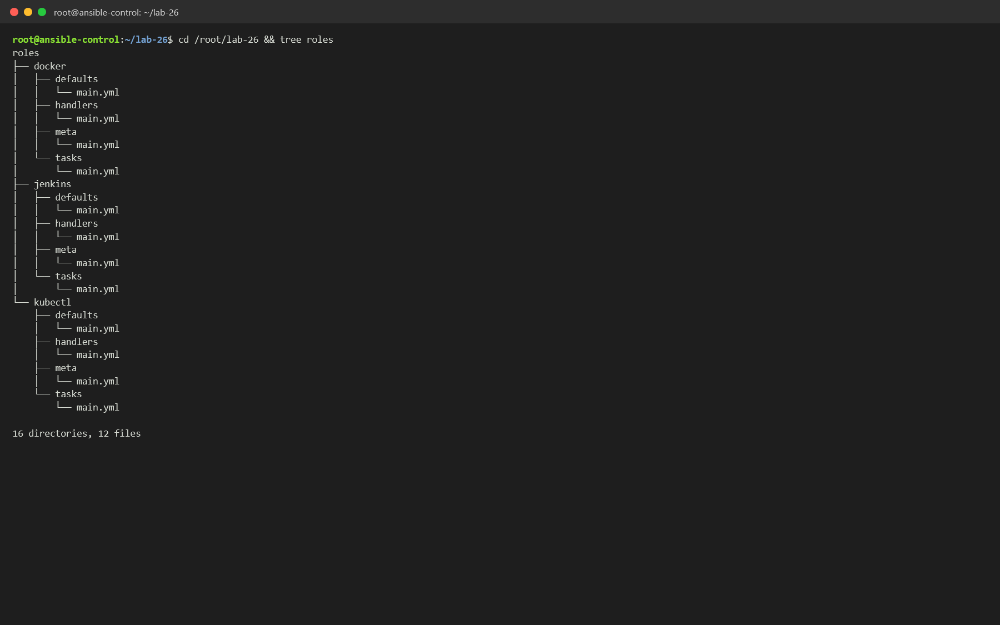
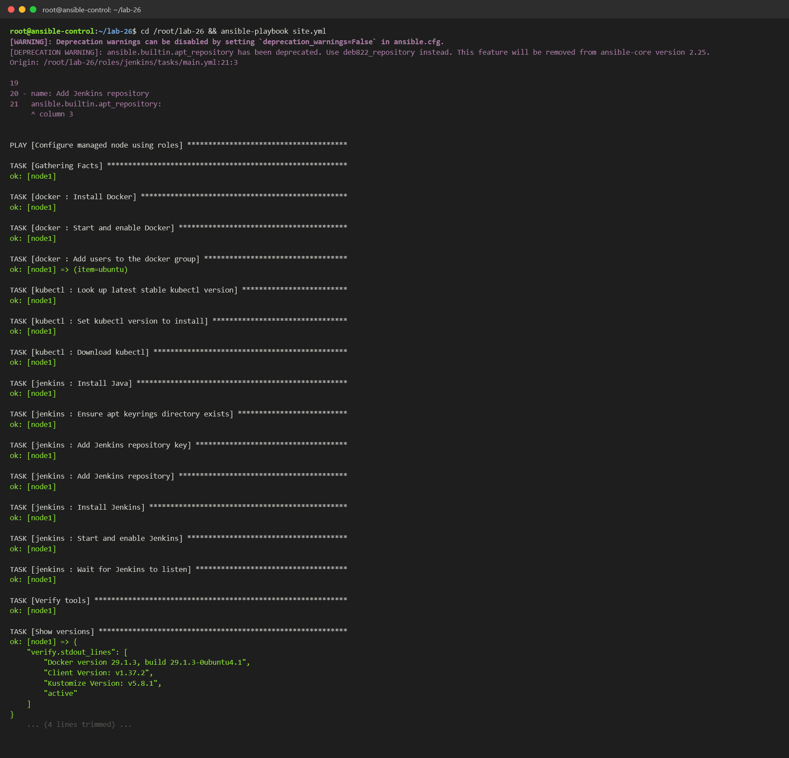

# Lab 26: Structured Configuration Management with Ansible Roles

## Objective

1. Create separate roles for Docker, kubectl and Jenkins.
2. Write a playbook that runs the roles.

> **How it was run:** the control node is a Linux container (`ansible-control`, Python 3.12 +
> `pip install ansible-core`) because `sudo` on the WSL machine needs a password. Any Linux
> control node works the same way. Managed node: AWS EC2 Ubuntu 26.04 (`75.101.215.238`).

## Structure

```text
lab-26/
├── ansible.cfg              # roles_path = ./roles
├── inventory.ini
├── site.yml                 # runs docker → kubectl → jenkins
└── roles/
    ├── docker/
    │   ├── defaults/main.yml    # docker_package, docker_users
    │   ├── handlers/main.yml    # Restart docker
    │   ├── meta/main.yml
    │   └── tasks/main.yml
    ├── kubectl/
    │   ├── defaults/main.yml    # kubectl_version (stable or pinned), arch, path
    │   ├── handlers/main.yml
    │   ├── meta/main.yml
    │   └── tasks/main.yml
    └── jenkins/
        ├── defaults/main.yml    # java package, repo key, port
        ├── handlers/main.yml    # Restart jenkins
        ├── meta/main.yml
        └── tasks/main.yml
```

The roles skeleton can be created with:

```bash
mkdir roles && cd roles
ansible-galaxy init docker
ansible-galaxy init kubectl
ansible-galaxy init jenkins
```



## Roles

| Role | Tasks | Variables (defaults) |
|---|---|---|
| `docker` | install package, start/enable, add users to `docker` group | `docker_package`, `docker_users` |
| `kubectl` | resolve version, download binary | `kubectl_version: stable`, `kubectl_arch: amd64` |
| `jenkins` | install Java, add repo + key, install, start/enable, wait for port 8080 | `jenkins_java_package`, `jenkins_port` |

Default values can be overridden in the playbook or with `-e`, e.g.
`ansible-playbook site.yml -e kubectl_version=v1.36.0`.

## Run

```bash
cp -r /mnt/f/nti/ivolve/IvolveT/lab-26 ~/ && cd ~/lab-26
# put the managed node IP in inventory.ini

ansible-playbook site.yml --syntax-check
ansible-playbook site.yml
ansible-playbook site.yml --list-tasks   # list tasks per role
```

Result: `ok=16 changed=0 failed=0`. Nothing changed because lab 25 had already installed the same
tools, which shows that the roles are idempotent:



## Verify

The `post_tasks` in `site.yml` print the versions. Manually:

```bash
ansible managed -m command -a "docker --version"
ansible managed -m command -a "kubectl version --client"
ansible managed -b -m command -a "systemctl is-active jenkins"
```

## Screenshots

| Step | Screenshot |
|---|---|
| Roles structure | [roles-tree.png](screenshots/roles-tree.png) |
| site.yml run | [site-run.png](screenshots/site-run.png) |
